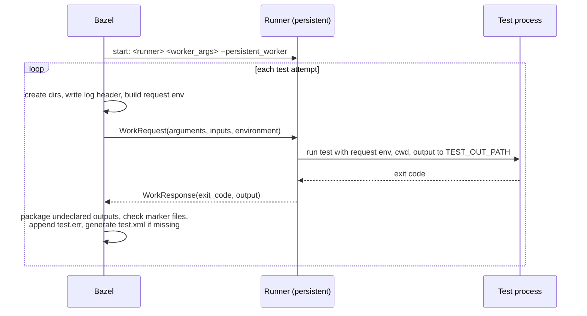

# Abstract

Every Bazel test starts a new process, and that process pays its startup cost before the first
assertion runs: process creation, JVM startup and JIT warmup, loading fixtures. Persistent
workers removed this cost for build actions years ago, but tests cannot use them.

This proposal adds a `PersistentTestInfo` provider. A Starlark test rule returns it to declare a
*test runner* that Bazel may keep alive as a persistent worker, and reuse across test attempts
and targets. When a test runs persistently, Bazel sends the runner one `WorkRequest` per test
attempt, carrying the test's arguments and its complete environment. When it does not (the
worker strategy is not selected, coverage, `--run_under`, remote or dynamic execution, Windows),
the same runner is started through the existing test wrapper exactly as a test binary is today.

The work is based on a Bazel prototype by John Cater ([@katre](https://github.com/katre)) and
Antonio Di Stefano ([@TheGrizzlyDev](https://github.com/TheGrizzlyDev)), and a matching runner for
`java_test` in `rules_java` by Antonio Di Stefano. On Bazel's own Java tests, that prototype reduced
the total of median test runtimes across 46 targets from 36.5 to 19.6 minutes: 46% less, or 1.9x
faster.

# Background

## Tests today

A test rule creates an executable and returns it in `DefaultInfo`. Bazel runs it inside a test
wrapper: `tools/test/test-setup.sh` on Unix and `tw.exe` on Windows. The contract between Bazel,
the wrapper and the test is the
[Test Encyclopedia](https://bazel.build/reference/test-encyclopedia):

- the environment carries everything the test needs: `TEST_TMPDIR`, `TEST_SRCDIR`, sharding
  (`TEST_TOTAL_SHARDS`, `TEST_SHARD_INDEX`, `TEST_SHARD_STATUS_FILE`), filtering
  (`TESTBRIDGE_TEST_ONLY`), `XML_OUTPUT_FILE`, undeclared outputs and so on;
- the exit code decides pass or fail;
- stdout and stderr become `test.log`;
- the test may write `test.xml`, and if it does not, Bazel generates one from the log and the
  exit code in a separate spawn.

The wrapper does real work before and after the test. It makes path variables absolute, creates
directories, sets `HOME` and the `GTEST_*` aliases, changes into the runfiles directory, writes
the log header that `--test_output=streamed` looks for, runs the test in its own process group,
cleans up child processes, and after the test writes the undeclared-outputs manifest,
concatenates annotations and zips the undeclared outputs.

## Persistent workers today

A worker action is created with `ctx.actions.run` and execution requirements such as
`supports-workers`, `supports-multiplex-workers`, `requires-worker-protocol` and
`worker-key-mnemonic`. Bazel decides whether the action actually runs persistently. A worker must
therefore support two modes:

- **single-shot:** the tool is started with its arguments, including a param file, and exits;
- **persistent:** the tool is started with `--persistent_worker`, reads `WorkRequest` messages
  from stdin, writes `WorkResponse` messages to stdout, and waits for the next `WorkRequest`.

Workers are pooled based on `WorkerKey`, which includes the tool, its startup arguments, its
environment, the mnemonic and the sandboxing and multiplexing bits. A worker may be singleplex
(one request at a time per process) or multiplex (many concurrent requests in one process), and
either may be sandboxed. `worker_protocol.proto` already has most of the fields this proposal
needs: `cancel` and `sandbox_dir` on `WorkRequest`, and `was_cancelled` on `WorkResponse`.
`WorkRequest` has no field for per-request environment variables. This proposal adds one (see
[Protocol changes](#protocol-changes)).

## History

Bazel had a persistent test runner from late 2019 to March 2022
(`--experimental_persistent_test_runner`). It was a Java test runner embedded in Bazel, tied to
the native `java_test`, and it was removed after problems with classpath changes during
incremental builds, state leaking between tests, and dependencies shared between the runner and
the code under test. This proposal does not revive it. Bazel provides a generic mechanism, and
each language's rules provide their own runner.

## Measured results

The prototype runner for `java_test` starts a coordinator that manages child JVMs. Before reusing
a child for a test it checks that the JVM startup configuration matches and that every jar the
child has loaded is unchanged. It then injects the test, runs JUnit and keeps the child alive.

Bazel's own Java tests were measured with the `local` strategy against the persistent worker:
46 Java test targets, 4 runs each, comparing the total of the median runtimes.

| | Total of median runtimes |
| --- | --- |
| `local` strategy | 36.5 min |
| Persistent worker | 19.6 min |
| Change | 46% less (1.9x) |

35 of the 46 targets got faster. The 11 that got slower are all short tests, under 14 seconds
each. Many of them are serialization tests that scan the classpath, which is slower in a
long-lived JVM. These numbers are for singleplex, unsandboxed workers. The sandboxed and
multiplex modes have not been measured.

## Terminology

- **Runner:** the process started from `PersistentTestInfo.worker_executable`.
- **Single-shot:** the runner is started once for one test attempt, through the test wrapper.
- **Persistent mode:** the runner is started with `--persistent_worker` and receives test attempts
  as `WorkRequest`s.
- **Test attempt:** one execution of one shard of one test, including each flaky retry.
- **Base env:** the environment the runner process is started with. It is part of the WorkerKey.
- **Request env:** `WorkRequest.environment` for one test attempt.
- **Path base:** the directory that relative paths in a request are relative to (see
  [Path bases](#path-bases)).
- **Fresh worker:** a runner process that has served no other request.

# Proposal

## Overview



The rule author writes one runner that works in both modes. In single-shot mode it is an ordinary
test binary and the wrapper does its usual work. In persistent mode there is no wrapper: Bazel
does every per-test duty that can be done from outside the runner process, and the runner does
the rest.

## Scope

In scope:

- The `testing.PersistentTestInfo` provider and its validation.
- Persistent mode for local, sandboxed, hardened sandboxed, multiplex and multiplex-sandboxed
  workers, on platforms other than Windows.
- The `--enable_persistent_test_runners` flag, and the single-shot fallback when a test cannot run
  persistently.
- The split of per-test duties between Bazel and the runner, including `test.log`, `test.xml`,
  undeclared outputs and `--test_output=streamed`.
- Crash handling, flaky retries on a fresh worker, caching, and timeouts. The timeout behavior is
  an open question.
- The new `WorkRequest.environment` field.
- The param-file handling in `test-setup.sh` and `tw.exe`, which single-shot mode needs on every
  platform.

| Execution | Persistent | Behavior |
| --- | --- | --- |
| Local worker, singleplex or multiplex | yes | as described in this proposal |
| Sandboxed, hardened sandboxed, multiplex-sandboxed worker | yes | as described in this proposal |
| Remote execution | no | single-shot, no error |
| Dynamic execution | no | single-shot, no error |
| Coverage | no | single-shot |
| `--run_under` | no | single-shot |
| Windows | no | single-shot through `tw.exe` |

Not in scope:

- **Remote execution.** The worker strategy runs workers on the machine that runs Bazel, and the
  duties Bazel does at request start and request end (log header, directories, undeclared
  outputs) run there too. A remote executor receives today's wrapper command line, which works
  without changes. Running test runners persistently on a remote executor would need the executor
  to do those duties, which is a separate design between Bazel and remote execution services.
  Remote execution support will be added in the future, in a separate proposal.
- **Dynamic execution.** Dynamic execution races a local spawn against a remote one and cancels
  the one that loses. The remote branch would be single-shot, since remote execution is out of
  scope. Cancelling the local branch would stop a test in the middle of a run, which depends on
  runner cancellation support. That support is optional in this proposal, and the timeout
  behavior that depends on it is still open.
- **Coverage.** Coverage collection is implemented in the wrapper by `collect_coverage.sh`, which
  runs around a single test process and post-processes its output for each language. Supporting
  it in persistent mode would mean reimplementing that work in Bazel or in every runner. Coverage
  runs work single-shot without changes.
- **`--run_under`.** `--run_under` puts a command, such as a debugger or a profiler, in front of
  the test binary, so it wraps one test process. A runner that serves many tests from one
  long-lived process cannot be wrapped that way.
- **Windows persistent mode.** Single-shot runs on Windows work through `tw.exe`, with only the
  param-file change. Persistent mode would need Windows implementations of the Bazel-side
  request-start and request-end duties, the log directory and the path handling. The prototype
  does not support Windows, so none of this has been tried. Windows support for persistent mode
  will be added in the future.
- **Runners for specific languages, including changes to rules_java.** Each language's rules own
  their runner, and the language-specific decisions, such as when a JVM can be reused, belong
  there. This proposal defines the mechanism. The prototype runner for `java_test` (linked in
  [Prototype](#prototype)) is an example of what a runner must do.
- **Changes to the single-shot contract.** Single-shot runs keep the Test Encyclopedia contract.
  Tests that do not adopt the provider see no change, and tests that do adopt it see the same
  contract whenever they run single-shot.
- **Isolation between tests beyond what the runner provides.** Bazel cannot reset state inside a
  runner process. It runs retries on a fresh worker and reports reuse, but isolation is the
  runner's responsibility (see [Failures, retries and caching](#failures-retries-and-caching)).
- **`WorkRequest.environment` for other workers.** The field's comment defines merge semantics
  for non-test workers, but Bazel sets the field only for test runners. Using it for other workers
  is a later change.

## The `PersistentTestInfo` provider

### Example

```python
def _worker_test_impl(ctx):
    runner = ctx.attr._runner[DefaultInfo].files_to_run
    test_args = ctx.actions.args()
    test_args.add_all(ctx.files.srcs)
    return [
        DefaultInfo(
            runfiles = ctx.runfiles(files = ctx.files.srcs).merge(
                ctx.attr._runner[DefaultInfo].default_runfiles),
        ),
        testing.PersistentTestInfo(
            worker_executable = runner,
            worker_key_mnemonic = "WorkerTest",
            requires_worker_protocol = "proto",
            multiplex = False,
            worker_args = ["--protocol=proto"],
            test_args = [test_args],
            test_inputs = depset(ctx.files.srcs),
        ),
    ]

worker_test = rule(
    implementation = _worker_test_impl,
    test = True,
    attrs = {
        "srcs": attr.label_list(allow_files = True),
        "_runner": attr.label(
            default = "//tools:test_runner",
            executable = True,
            cfg = "exec",
        ),
    },
)
```

### Fields

| Field | Type | Default | In WorkerKey | Execution requirement | Meaning |
| --- | --- | --- | --- | --- | --- |
| `worker_executable` | File or FilesToRunProvider | required | yes | (spawn tools) | The runner. It replaces the test executable in both modes. |
| `worker_key_mnemonic` | string | required | yes | `worker-key-mnemonic` | Names the runner for gating, worker flags and pooling. |
| `worker_args` | list of string or Args | `[]` | yes | | Startup arguments. A change starts a new worker. |
| `test_args` | list of string or Args | `[]` | no | | Per-test arguments, passed in the param file. |
| `test_inputs` | depset of File | empty | no | | Extra action inputs the runner reads by exec path. |
| `requires_worker_protocol` | `"proto"` or `"json"` | `"proto"` | yes | `requires-worker-protocol` | The worker protocol. |
| `multiplex` | bool | `False` | yes | `supports-multiplex-workers` | The runner may serve concurrent requests in one process. |
| `supports_multiplex_sandboxing` | bool | `False` | yes | `supports-multiplex-sandboxing` | The runner honors `WorkRequest.sandbox_dir`. |
| `supports_cancellation` | bool | `False` | yes | `supports-worker-cancellation` | The runner honors cancel requests. |

Notes:

- `worker_executable` must be in the test's runfiles. `TEST_BINARY` is its runfiles path.
- `DefaultInfo.executable` must be unset or equal to `worker_executable`. Any other value is an
  error.
- `worker_args` are runfiles-relative: path-valued arguments must be runfiles paths
  (`short_path` / rlocation paths), and the runner resolves them through `RUNFILES_DIR` in both
  modes. They must not contain `@...`, `--flagfile=` or `--persistent_worker`.
- `test_args` may contain exec paths, such as files from `test_inputs`. In single-shot mode the
  wrapper makes them absolute (see [Single-shot](#single-shot)). In persistent mode they resolve
  against the path base.
- The WorkerKey includes the digests of `worker_executable` and of its own runfiles (the
  runfiles of its `FilesToRunProvider`), not of the test's runfiles.
  - A change to any of those files starts a new worker. Files that differ between tests must not
    be in the runner's runfiles: put them in the test's runfiles or in `test_inputs`.
  - A File passed as `worker_executable` must come from an executable attribute, so that its
    runfiles are known; any other File is an error. A rule that generates a `worker_executable`
    per target gets one worker per target.
- `test_inputs` are per-request inputs.
  - They are never part of the WorkerKey, whether or not they are also in runfiles.
  - They are sent in `WorkRequest.inputs` with their digests, so the runner can see which files
    changed between requests.
- Every field that affects execution reaches the test action's key through the command line, the
  inputs or the execution info. Enabling or disabling persistent mode does not change the key.

### Validation

- Returning `PersistentTestInfo` from a rule that is not a test rule is an error.
- `supports_multiplex_sandboxing = True` without `multiplex = True` is an error.
- A File `worker_executable` that does not come from an executable attribute is an error.
- `--persistent_worker` in `test_args`, the rule's `args` attribute or `--test_arg` is an error.
  Without this check, `--test_arg=--persistent_worker` would switch a single-shot runner into
  worker mode, the runner would read end-of-file on stdin and exit 0, and the test would pass
  without running.
- `testing.PersistentTestInfo` is behind an experimental flag until this design is approved.

## Execution modes

The test spawn is built once, before Bazel chooses a strategy. Both modes therefore use the same
command line and the same param file. What differs is how Bazel starts the runner.

### Single-shot

The command line is today's test command with the runner in place of the test executable:

```
test-setup.sh [collect_coverage.sh] [run_under] <runner> <worker_args...> @<paramfile>
```

The param file contains `test_args`, then the rule's `args`, then `--test_arg` values, one per
line. Single-shot mode keeps the wrapper (`test-setup.sh` / `tw.exe`), with one change: the
wrapper handles the param file. Before it changes into the runfiles directory, the wrapper:

1. rewrites `@<path>` to an absolute path, because the relative path does not exist from the
   runfiles directory;
2. writes a new param file in which every relative entry before a `--` line that names an
   existing file is made absolute. The original file is not modified, so the rewrite cannot
   change anything outside a sandbox.

The prototype already does this in `test-setup.sh`. `tw.exe` needs the same change. Because the
rewrite recognizes paths by checking whether a file exists, a non-path argument that happens to
match a relative file name is also rewritten. Rules that pass such arguments should put them
after a `--` line.

Keeping the wrapper for single-shot is the deliberate choice:

- **One spawn serves both modes.** The spawn is built before the strategy is chosen, so it cannot
  differ by mode. In persistent mode Bazel removes the wrapper prefix from the command line. It
  does this from structured data recorded on the spawn (the runner's position in the command),
  not by matching file names such as `test-setup.sh`.
- **Coverage and `--run_under` keep working.** Both are implemented in the wrapper
  (`collect_coverage.sh`, the run_under prefix). Neither needs new code.
- **Windows keeps working.** `tw.exe` runs the runner like any other test binary.
- **Out-of-scope strategies need no new code.** Remote and dynamic execution send the same
  wrapper command line they send today.
- **The single-shot contract stays the Test Encyclopedia.** Nothing changes for tests that do not
  adopt the provider, and adopting the provider does not change what the test sees in
  single-shot mode.

What this means for runner authors:

- The runner must behave as an ordinary test binary when it is *not* started with
  `--persistent_worker`. It reads its per-test arguments from the param file. It must not repeat
  any duty the wrapper already does, such as making paths absolute or zipping undeclared outputs.
- The runner decides its mode only from its own startup arguments, never from request arguments.
  In persistent mode, `--persistent_worker` may be followed by values from
  `--worker_extra_flag`.
- The runner receives `worker_args` in both modes.

### Persistent

Bazel starts the runner as:

```
<runner> <worker_args...> --persistent_worker [worker extra flags...]
```

with the base env (see [Environment](#environment)) and the path base as its working directory.
For each test attempt Bazel sends a `WorkRequest`:

- `arguments`: the expanded contents of the param file, in the same order as single-shot;
- `inputs`: every input of the test action, with digests;
- `environment`: the complete test environment. This is a new field in `WorkRequest` (see
  [Protocol changes](#protocol-changes));
- `sandbox_dir`: set for multiplex-sandboxed workers;
- `request_id`: set for multiplex workers.

### Enabling persistent mode

Persistent mode is off by default. A test runs persistently only if all of these hold:

1. its rule returns `PersistentTestInfo`;
2. `--enable_persistent_test_runners=<regex>` matches its full `worker_key_mnemonic`;
3. the `TestRunner` strategy list selects `worker` for the spawn, for example
   `--strategy=TestRunner=worker,local`;
4. nothing forces single-shot: coverage, `--run_under`, Windows, dynamic execution, or a test
   tagged `requires-network` under `--experimental_worker_sandbox_hardening`.

`--enable_persistent_test_runners` is an execution option, so changing it does not discard the
analysis cache. The choice is made when the test spawn is built.

| Provider | Regex matches | Strategy list | Forced single-shot | Result |
| --- | --- | --- | --- | --- |
| no | | any | | Single-shot, as today. |
| yes | no | any | | Single-shot. |
| yes | yes | no `worker` | | Single-shot. |
| yes | yes | `worker` first | no | Persistent. |
| yes | yes | `worker,local` or `worker,sandboxed` | yes | Single-shot through the next strategy. One INFO message per invocation lists the reasons. |
| yes | yes | `worker` only | yes | Error: no usable spawn strategy (Bazel's existing error). |

The last row also applies to the test.xml and coverage helper spawns, which use the `TestRunner`
mnemonic and never have worker requirements. Users should always list a fallback strategy after
`worker`. There is no per-target opt-out tag in this version; a rule can leave out the provider,
and users can narrow the regex.

The effective worker mode comes from the provider fields and the existing worker flags:

| `multiplex` | Flags | Mode |
| --- | --- | --- |
| `False` | `--worker_sandboxing` off for the mnemonic | Local |
| `False` | `--worker_sandboxing` on | Sandboxed |
| `False` | `--worker_sandboxing` and `--experimental_worker_sandbox_hardening` | Hardened sandboxed |
| `True` | `--worker_multiplex` (the default) | Multiplex |
| `True` | `--worker_multiplex`, `--experimental_worker_multiplex_sandboxing`, and `supports_multiplex_sandboxing = True` | Multiplex-sandboxed |
| `True` | `--noworker_multiplex` | One of the singleplex rows above |

## Per-test duties

In persistent mode the wrapper does not run. This table assigns every wrapper duty to Bazel or
to the runner, and gives the phase in which it is done:

- **request start:** Bazel, after it has prepared the worker's sandbox and before it sends the
  request;
- **during the request:** the runner, between receiving the `WorkRequest` and sending the
  `WorkResponse`;
- **request end:** Bazel, after the response and before outputs are copied out of the sandbox;
- **after the spawn:** Bazel, in the test strategy, where these checks already run for every
  strategy.

| Duty | Owner | Phase |
| --- | --- | --- |
| Set `TEST_OUT_PATH` | Bazel | request start |
| Write the log header to `TEST_OUT_PATH` | Bazel | request start |
| Set `BAZEL_TEST=1`, `USER` if unset, `HOME` (to `TEST_TMPDIR` unless absolute), the `GTEST_*` aliases and the `RUNFILES_MANIFEST_*` variables | Bazel | request start |
| Make path variables absolute against the path base: `TEST_SRCDIR`, `TEST_TMPDIR`, `RUNFILES_DIR`, `JAVA_RUNFILES`, `PYTHON_RUNFILES`, `XML_OUTPUT_FILE`, `TEST_SHARD_STATUS_FILE`, `TEST_PREMATURE_EXIT_FILE`, `TEST_WARNINGS_OUTPUT_FILE`, `TEST_INFRASTRUCTURE_FAILURE_FILE`, `TEST_LOGSPLITTER_OUTPUT_FILE`, `TEST_UNUSED_RUNFILES_LOG_FILE`, `TEST_UNDECLARED_OUTPUTS_DIR`, `TEST_UNDECLARED_OUTPUTS_ANNOTATIONS_DIR` | Bazel | request start |
| Prepend the absolute runfiles directory to `PATH` (the wrapper prepends `.`) | Bazel | request start |
| Leave `TEST_UNDECLARED_OUTPUTS_MANIFEST`, `_ZIP` and `_ANNOTATIONS` out of the request env | Bazel | request start |
| Fail the test if `RUNFILES_DIR` does not exist | Bazel | request start |
| Create `TEST_TMPDIR` (empty), the shard-status, XML, undeclared-outputs and annotations directories | Bazel | request start |
| Decide what to do with request environment variables it cannot apply (see [Environment](#environment)) | Runner | during the request |
| Run the test with exactly the request env, minus `TEST_OUT_PATH`; a runner that runs tests inside its own process honors the intent of each variable instead (see [Sandboxing and multiplexing](#sandboxing-and-multiplexing)) | Runner | during the request |
| Run the test in `TEST_SRCDIR/TEST_WORKSPACE`, unless `RUNTEST_PRESERVE_CWD` is set | Runner | during the request |
| Give the test an empty stdin | Runner | during the request |
| Send the test's stdout and stderr to `TEST_OUT_PATH` | Runner | during the request |
| Test filtering (`TESTBRIDGE_TEST_ONLY`), sharding (including touching `TEST_SHARD_STATUS_FILE`), `XML_OUTPUT_FILE`, warnings, premature-exit and infrastructure-failure files, `TEST_RANDOM_SEED`, `TEST_RUN_NUMBER` | Runner, or the test framework it runs | during the request |
| Kill the test's child processes when the test ends or is cancelled | Runner | during the request |
| Report the exit code in `WorkResponse.exit_code`, with 128+N for a test killed by signal N | Runner | during the request |
| Isolate tests from each other and reset state between them | Runner | during the request |
| Write the undeclared-outputs manifest, concatenate the `*.part` and `*.pb` annotations, zip the undeclared outputs and delete the originals | Bazel | request end |
| Check and delete the premature-exit file; check the shard-status file | Bazel | after the spawn (existing) |
| Append `WorkResponse.output` and Bazel's own messages to `test.log` | Bazel | after the spawn (partially existing) |
| Generate `test.xml` if the runner did not write it | Bazel | after the spawn (existing) |

Notes:

- When Bazel packages undeclared outputs, it detects MIME types from the file extension and uses
  `application/octet-stream` when it cannot, as `tw.exe` does. A packaging failure fails the test,
  as in the wrapper.
- Bazel does not put per-request absolute paths, `TEST_OUT_PATH`, `USER` or `BAZEL_TEST` into the
  spawn's environment. That environment feeds the action cache key and the WorkerKey, and
  per-request values there would split the worker pool and the cache.
- Duties that are not needed in persistent mode: coverage and `--run_under` (always single-shot),
  `TEST_SHORT_EXEC_PATH` and `BUILD_EXECROOT` (used for `bazel run` and coverage), and the
  wrapper's runfiles shim (the runner resolves runfiles itself).

### Path bases

| Mode | Path base |
| --- | --- |
| Local, multiplex | the execroot |
| Sandboxed, hardened sandboxed | the worker's sandbox directory |
| Multiplex-sandboxed | `WorkRequest.sandbox_dir` |

Bazel creates `TEST_TMPDIR` and the output directories under the path base. In sandboxed modes
the sandbox is cleaned before each request, which also cleans up after the previous test.

## Environment

Bazel computes the test environment as it does today, then applies the changes the wrapper would
make (table above). The result is the *test-visible environment*: exactly what the wrapper would
start the test with. Bazel sends all of it in `WorkRequest.environment`.

| Origin | Example | Base env | Request env |
| --- | --- | --- | --- |
| Policy constants | `TZ=UTC`, `LANG` | yes | yes |
| `--action_env` | `PATH` | yes | yes |
| Local environment rewriting | `TMPDIR`, `DEVELOPER_DIR`, `SDKROOT` | yes | yes |
| `--test_env`, rule `env` | user values | no | yes |
| Per-test setup | `TEST_TARGET`, shard and run variables, `TESTBRIDGE_TEST_ONLY` | no | yes |
| Wrapper-derived | `BAZEL_TEST`, `HOME`, `USER`, `GTEST_*` | no | yes |
| Hidden | `TEST_UNDECLARED_OUTPUTS_MANIFEST`, `_ZIP`, `_ANNOTATIONS` | no | no |
| Persistent only | `TEST_OUT_PATH` | no | yes; not passed to the test |

Rules:

- The base environment holds only values that are the same for every test that can share a
  worker. A change to `--action_env` therefore starts a new worker, which matches the action key.
- The request environment repeats the base values. Where a key is in both, the request value wins.
- A variable that is absent from the request environment is unset for the test.
- `TEST_OUT_PATH` is a reserved name. The runner removes it from the environment it gives the
  test, so the test sees the same variables in both modes.

A runner applies a variable by honoring its intent. That need not mean setting it in a process
environment: a runner that runs tests inside its own process applies `TEST_TMPDIR`, for example,
by using it as the test's temporary directory (see
[Sandboxing and multiplexing](#sandboxing-and-multiplexing)).

Some variables cannot be applied per test by every runner. For example, a runner that reuses a
JVM cannot change `JAVA_TOOL_OPTIONS` for a JVM that is already running. Bazel does not classify
variables. The runner decides what to do with each one. It may:

- print an error to `TEST_OUT_PATH` and fail the test; or
- ignore a variable that makes no sense for how it runs tests. If it does, it must name every
  ignored variable in the test log, so a difference between persistent and single-shot results
  can be traced back to it.

## Test log and test.xml

Bazel produces `test.log` in both modes, and generates `test.xml` when the runner does not write
it. In persistent mode:

1. When the worker starts, Bazel creates a log directory for it. The directory is owned by Bazel
   and is writable by the worker from the start, in every mode.
2. At request start, Bazel creates a new file in that directory, writes the same header the
   wrapper writes, and sets `TEST_OUT_PATH` to the file's absolute path:

   ```
   exec ${PAGER:-/usr/bin/less} "$0" || exit 1
   Executing tests from //pkg:target
   -----------------------------------------------------------------------------
   ```

3. The runner opens the file for appending, never truncates it, and sends the test's stdout and
   stderr there. Before it sends the `WorkResponse`, the test and all its children must have
   stopped writing.
4. While the test runs, `--test_output=streamed` follows the file. Streamed output forces
   `--test_strategy=exclusive` and disables sharding, but it does not force a local spawn, so
   streamed tests can still run persistently.
5. After the response, Bazel copies the file into `test.log`, then appends `WorkResponse.output`
   and its own messages, as it does today. The copy, rather than a rename, means that a test
   which keeps writing after its timeout writes only to a file nobody reads.

`WorkResponse.output` is for the runner's own diagnostics. The runner's stdout is the protocol
channel and its stderr goes to the worker log, which users do not normally see.

The log directory is shared by every test the worker runs, so a test can read or write log files
of earlier or concurrent tests on the same worker. Bazel deletes each file after copying it and
deletes the directory when the worker is destroyed.

A per-worker directory is used, rather than a path per test, for these reasons:

- **The hardened worker sandbox fixes its writable paths when the process starts.** A per-test log
  path cannot be made writable later.
- **Log paths are not known when the worker starts.** `test.log` paths depend on the target, the
  configuration and the attempt.
- **Making `bazel-testlogs` writable would expose every test's logs to every test.**
- **One mechanism for every mode.** The runner contract is the same unsandboxed, sandboxed,
  hardened and multiplex-sandboxed.
- **It follows existing practice.** Sandboxed workers already have a per-worker temporary
  directory that survives cleanup between requests.

Two other designs were considered:

- **A log file inside the sandbox, declared as a spawn output.** Spawn outputs are copied out only
  after the request finishes, so `--test_output=streamed` would show nothing until the end.
- **Return the whole log in `WorkResponse.output`.** This is the simplest for runners, and it
  remains possible. But the whole log is held in memory, a proto message is limited to 2 GB,
  the field must be UTF-8, and streamed output appears only at the end.

## Sandboxing and multiplexing

**Isolation.** cwd, environment, file descriptors, `HOME`, signal handling and process groups
belong to a whole process, not to one test. In every mode, singleplex or multiplex, a runner MAY
run each test in a process it starts with the request's environment, working directory and file
descriptors, or MAY run tests inside its own process.

- A runner that runs tests inside its own process MUST still honor the intent of each request
  variable, even when it does not apply it as a process environment variable. For example, it
  uses the request's `TEST_TMPDIR` as the test's temporary directory, writes `test.xml` to the
  request's `XML_OUTPUT_FILE`, runs only the shard given by `TEST_SHARD_INDEX`, and resolves the
  test's relative paths against the request's working directory, not its own.
- A multiplex runner that runs tests inside its own process runs them concurrently, so it MUST NOT
  keep any of this per-test state in process-wide settings.
- A variable whose intent the runner cannot honor is a variable it cannot apply (see
  [Environment](#environment)): the runner fails the test, or ignores the variable and names it in
  the test log.
- A runner that runs tests inside its own process MUST document which Test Encyclopedia guarantees
  it weakens.
- In every mode, test code MUST NOT write to the runner's stdout or read the runner's stdin. Either
  would corrupt the protocol.

**Non-hardened sandboxing.** Sandboxed singleplex workers and multiplex-sandboxed workers stage
inputs into a separate directory, but they do not confine the filesystem. A test can read and
write outside its sandbox.

**Hardened sandboxing.** Under `--experimental_worker_sandbox_hardening`:

- the worker always runs in a network namespace with no network, so tests tagged
  `requires-network` run single-shot instead;
- `/tmp` is shared by every test the worker runs. `TMPDIR` and `TEST_TMPDIR` point at the per-test
  directory, so tests that use them do not share files.

## Failures, retries and caching

| Case | Result | Cached | Worker |
| --- | --- | --- | --- |
| Response with exit code 0 | PASSED | as single-shot | kept |
| Response with a non-zero exit code | FAILED | as single-shot | kept |
| Runner exits or closes stdout while this request is running | FAILED, "test runner exited" | no | discarded |
| Response cannot be parsed (for example, test code wrote to the runner's stdout) | FAILED, "test runner exited" | no | discarded |
| Another request in the same multiplex process caused it to exit | FAILED, "test runner exited while running another test" | no | discarded |
| `was_cancelled` set without a cancel request | FAILED, "test runner exited" | no | discarded |
| Test killed by signal N | FAILED, exit code 128+N | as single-shot | kept |
| Runner exited after a complete response | not a test result | n/a | replaced before the next request |

In the "test runner exited" cases, Bazel appends the end of the worker log to the test's log.
Those results are not cached because the cause may be state left by an earlier test.

A runner may exit on purpose after it has written and flushed a complete response, for example
when it detects state it cannot reset. That is not a failure: Bazel starts a new worker for the
next request.

**Retries.** Failed attempts are retried only through `--flaky_test_attempts`. Each retry runs on
a fresh worker: Bazel adds the attempt number to the WorkerKey of the retry spawn, and discards
that worker after the attempt. This works for multiplex workers too. It costs one cold start per
retry. When the failed attempt ran on a reused worker, Bazel says so in the retry's log and in
the Build Event Protocol.

**Caching.** Persistent results are cached the same way as single-shot results, and the two share
cache entries. A runner that leaks state between tests can produce a cached result that a
single-shot run would not reproduce. Isolation is the runner's responsibility; Bazel's
contribution is the fresh-worker retry, the reuse note in the log, and the BEP fields below.

**Reporting.** BEP test results record whether the attempt ran persistently and how many requests
the worker had served before it. Time spent waiting for a free worker is reported separately
from test time, using the existing spawn metrics.

## Timeouts

**This is unresolved.** The following applies whichever option is chosen:

- Test status is TIMEOUT, the exit code is 142, and the `test.xml` fallback runs with that code.
- If `supports_cancellation = True`, Bazel sends a cancel request at the timeout. This does not
  also require worker sandboxing or `--experimental_worker_cancellation`.
- All test runners are strongly encouraged to implement cancellation. It is not mandatory,
  including for multiplex runners.
- Multiplex test workers are subject to the timeout. Bazel waits for a multiplex response with a
  deadline, as it does for singleplex.
- `TEST_TIMEOUT` is in the request env, so runners can enforce their own timeout.
- A retry after a timeout runs on a fresh worker.

The options for a runner that does not finish by the timeout:

| | A: report, never kill | B: kill after a grace period | C: kill at the timeout |
| --- | --- | --- | --- |
| Behavior | Report TIMEOUT. Discard any later response. Never kill the worker. | Cancel, wait for a grace period (for example `--local_termination_grace_seconds`), then kill the worker. | Kill the worker at the timeout, without a cancel. |
| Worker | Kept; not reused until its late response arrives. | Killed. | Killed. |
| Resources | The process and its pool slot stay held. If enough tests hang, later tests for that WorkerKey wait for `--worker_max_instances`. | Released after the grace period. | Released at once. |
| Late writes | The test can keep writing to its log file and, if unsandboxed, to output directories. | Until the kill. | None. |
| Multiplex | Bazel must track the abandoned request and drain its response. | The kill fails every other test in the process. | Same as B. |

## Protocol changes

**`WorkRequest.environment`.** A new field 7 is added to `WorkRequest` in `worker_protocol.proto`:

```proto
  // Environment variables for this request.
  //
  // For requests sent to a persistent test runner (a worker started for a
  // test rule that returns PersistentTestInfo), this is the complete
  // environment of the test. The runner must apply exactly these variables
  // to the test, honoring the intent of each one even when it runs the test
  // inside its own process. A variable that is absent from this map is unset
  // for the test, even if it is set in the worker's base environment.
  //
  // For all other workers, these environment variables should be merged with
  // the worker's base environment. They override any existing environment
  // variables with the same name.
  map<string, string> environment = 7;
```

Field 7 is the next free number: on `master`, `WorkRequest` ends at field 6 (`sandbox_dir`). Bazel
sets the field only on requests to persistent test runners. The comment also defines merge
semantics for other workers, so a later change can send per-request environment variables to them
without changing the field's meaning. A runner knows it is a test runner because it was built as
one, so a single worker binary should not serve both test and non-test requests.

On the Bazel side, JSON requests are printed from the proto, so the new field is sent without
further changes. The worker-side JSON request reader, `JsonWorkerMessageProcessor`, reads only
known keys: it does not read `cancel` today, and it will not read `environment` until it is
updated. It exists in two copies: one in Bazel, used by Bazel's own workers such as JavaBuilder,
and one published as the
[`bazel_worker_java`](https://github.com/bazelbuild/bazel-worker-api/tree/main/java) module, used
by rule sets such as `rules_android` and `rules_jvm_external`. Updating both copies and releasing a
new `bazel_worker_java` is a separate, later change, not part of the stages in
[Staging](#staging). Until then, JSON runners built on either copy receive neither field, and
JSON runners built on a released `bazel_worker_java` receive them only after they upgrade.

**Reserved names.** `--persistent_worker` is reserved in test arguments (see
[Validation](#validation)). `TEST_OUT_PATH` is a reserved environment variable.

## Requirements for runner authors

A runner MUST:

- behave as an ordinary test binary unless started with `--persistent_worker`, reading per-test
  arguments from the param file;
- decide its mode only from its startup arguments, and accept worker extra flags after
  `--persistent_worker`;
- treat `WorkRequest.environment` as the complete test environment, and remove `TEST_OUT_PATH`
  from what it gives the test;
- either fail the test with an error, or ignore and name in the log, any request variable it
  cannot apply;
- run the test in `TEST_SRCDIR/TEST_WORKSPACE` unless `RUNTEST_PRESERVE_CWD` is set, with an empty
  stdin;
- append the test's stdout and stderr to `TEST_OUT_PATH`, and make sure nothing is still writing
  to it before sending the response;
- honor test filtering, sharding (including the shard-status file), `XML_OUTPUT_FILE` and the
  other Test Encyclopedia variables, as a test framework would in single-shot mode;
- kill the test's child processes when the test ends or is cancelled;
- report the exit code, using 128+N for a test killed by signal N;
- keep test code away from its own stdin and stdout;
- if it runs tests inside its own process, in either mode, honor the intent of every request
  variable, keep no per-test state in process-wide settings when multiplexed, and document which
  Test Encyclopedia guarantees it weakens.

A runner MUST NOT:

- repeat duties Bazel does in persistent mode, such as zipping undeclared outputs or writing the
  log header;
- repeat duties the wrapper does in single-shot mode.

A runner SHOULD:

- implement cancellation and set `supports_cancellation = True`;
- exit after a complete response when it detects state it cannot reset;
- use `WorkRequest.inputs` digests to decide when cached state is stale.

# Alternatives considered

- **Extend `ctx.actions.run` with a `test = True` parameter to create test actions.** This is
  more flexible, but it is a much larger change to how tests execute, and would take much longer
  to design and land.
- **No wrapper in single-shot mode either.** Coverage, `--run_under`, Windows and remote
  execution all depend on the wrapper. Removing it would need new code in each, including
  strategies that are out of scope.
- **Run the wrapper inside the persistent worker.** The wrapper's environment is fixed when its
  process starts, so it cannot serve per-test values. It would also require every runner to start
  a subprocess for each test, which this proposal does not require.
- **Inline arguments, with a param file only in persistent mode.** The spawn is built before the
  strategy is chosen, so its command line cannot depend on the mode.
- **No param file in either mode,** with Bazel building `WorkRequest.arguments` directly. This
  needs new code in the worker strategy, which today requires a flag file. Keeping the param file
  gives the runner the same arguments in both modes.
- **Remove wrapper arguments by matching file names** (as the prototype matches `test-setup.sh`).
  This misses `tw.exe` and `--run_under`. The runner's position is recorded on the spawn instead.
- **Collect coverage inside the persistent runner.** Coverage runs single-shot, where
  `collect_coverage.sh` already works.
- **Put the whole test environment in the WorkerKey.** Per-test values would mean no worker is
  ever reused.
- **A fixed list of test variable names in Bazel's worker code.** The split by origin (base env and
  request env) is defined by where values come from, not by name.
- **A provider field listing variables that must be in the WorkerKey.** Bazel would start a new
  worker when those values change. Leaving the decision to the runner is simpler, and the runner
  is the only party that knows which variables it can apply.
- **A separate `environment_is_complete` field** to say whether `environment` replaces or is
  merged with the base env. Only test runners receive `environment` in this proposal, so the extra
  field adds nothing.
- **Logs: a sandbox-local log file, or `WorkResponse.output` only.** See
  [Test log and test.xml](#test-log-and-testxml).
- **Run flaky retries single-shot** instead of on a fresh worker. This needs a non-worker strategy
  in the list and gives up the warm runner for retries, but it is a reasonable fallback if the
  WorkerKey change proves difficult.
- **Invalidate the worker after any failure.** The next request may still get another reused
  worker, so it does not guarantee a fresh process.
- **Singleplex only for the first version.** Multiplex is in scope because the duty split and the
  isolation rule cover it, and multiplex runners are needed for languages where a process per
  test is expensive.
- **A separate mnemonic for persistent-capable test spawns.** Keeping `TestRunner` means existing
  `--strategy=TestRunner=...` settings apply unchanged.
- **Reuse `--experimental_worker_allowlist` instead of a new flag.** A test-specific flag keeps
  enabling persistent tests separate from other workers.

# Implementation

## Prototype

- Bazel, by John Cater and Antonio Di Stefano:
  [TheGrizzlyDev/bazel at `a2dc06c`](https://github.com/TheGrizzlyDev/bazel/tree/a2dc06cdfed6d5e2819413516117e4bc397d077e)
  (branch `persistent-test-workers`)
- rules_java, by Antonio Di Stefano:
  [TheGrizzlyDev/rules_java at `bb15268`](https://github.com/TheGrizzlyDev/rules_java/tree/bb152685c6840454749095703519ef93175cbc81)
  (branch `persistent-test-workers`)

The prototype implements the provider, the gating flag, the `WorkRequest.environment` field,
singleplex local and sandboxed workers, the param-file handling in `test-setup.sh`, and a
`java_test` runner.

## Changes required relative to the prototype

| Requirement | Prototype |
| --- | --- |
| Drop `ctx` and `worker_tools`; add `supports_cancellation` and `supports_multiplex_sandboxing`; make `worker_executable` and `worker_key_mnemonic` required | has `ctx` and `worker_tools` |
| `--enable_persistent_test_runners` as an execution option | build option |
| Record the runner's position on the spawn instead of matching `test-setup.sh` by name | matches by name |
| Multiplex and multiplex-sandboxed test spawns use the persistent-test path | singleplex only |
| Bazel does its request-start and request-end duties inside the worker strategy | partly in the test strategy |
| Undeclared outputs packaged by Bazel at request end | not packaged |
| Per-worker log directory and `TEST_OUT_PATH` | log returned in `WorkResponse.output` |
| Complete request env, split by origin | name-based list of test variables |
| Coverage and `--run_under` force single-shot | coverage collected in the worker |
| Fresh worker for retries; crash case table | not implemented |
| Timeouts, including multiplex | singleplex only; multiplex has no timeout |
| Param-file rewrite writes a new file; same change in `tw.exe` | rewrites in place; Unix only |
| A File `worker_executable` that does not come from an executable attribute is an analysis error | falls back to the test's runfiles tree as the worker's tool files, which puts every test-specific file in the WorkerKey |

## Staging

1. The provider, validation and action key, with single-shot only.
2. The structured runner command and the param-file change in both wrappers.
3. The `WorkRequest.environment` field, and singleplex local workers.
4. Sandboxed and hardened sandboxed workers.
5. Multiplex workers.
6. Multiplex-sandboxed workers.
7. Documentation.

## Testing

- Unit tests: environment split, request building, log header and append order, argument
  validation, provider validation, action key stability across the enable flag.
- A reference runner under Bazel's test helpers, used by integration tests for each mode:
  streamed output, the hardened sandbox log directory, undeclared outputs, retries on a different
  worker, each crash case, shard and premature-exit files, test.xml from the runner and from
  Bazel, timeouts including multiplex, and single-shot fallback for each forced case.

# Backward-compatibility

The change is additive.

- With `--enable_persistent_test_runners` unset (the default), behavior is unchanged for all
  tests, including tests whose rules return `PersistentTestInfo`.
- `testing.PersistentTestInfo` is experimental until this design is approved.
- `WorkRequest.environment` is a new field. Bazel sets it only on requests to persistent test
  runners, so other workers receive the same requests as today.
- When a rule adopts the provider, its test command line changes once (the runner replaces the
  test executable and a param file is added). This changes the test's cache key.
- `--test_arg=--persistent_worker` becomes an error for targets whose rules return the provider.
- The param-file change to `test-setup.sh` and `tw.exe` affects only command lines that contain
  an `@` argument, which only tests using the provider have.
- Persistent and single-shot results share cache entries.

# Open questions

1. **Timeout behavior.** Which of options A, B or C applies when a runner does not finish by the
   timeout? See [Timeouts](#timeouts).

# Acknowledgements

Antonio Di Stefano ([@TheGrizzlyDev](https://github.com/TheGrizzlyDev)) built the Bazel prototype
with the author, built the `java_test` runner in rules_java, and helped with the measurements in
this document. The two presented the work at BazelCon 2026.
